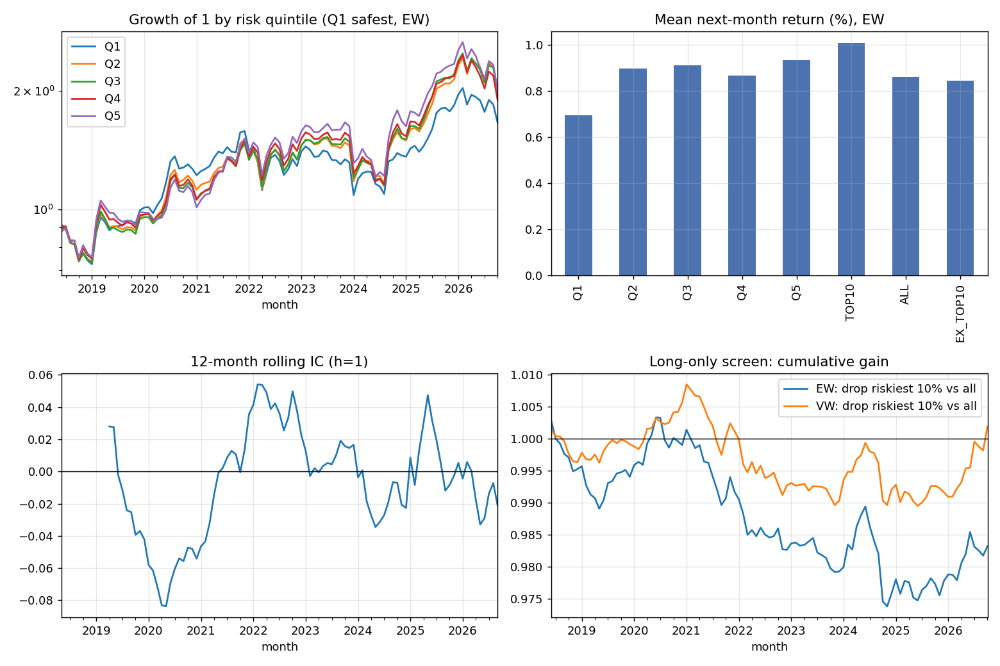

# Screener risk score -> A-share returns

- Data: REAL (walk-forward screener scores + AKShare/Eastmoney monthly prices)
- Scores: `alpha/output/scores_walkforward_tuned.csv` (FY Y score usable from 1 May of Y+1)
- Sample: 2018-05 to 2026-09 formation months (101), 5,051 stocks, avg 4,168 stocks/month
- Filters: >= 6 months since listing; traded in the formation month; next month's price available

**Hypothesis:** higher risk score -> lower future return (mean IC < 0, Q1 - Q5 > 0, dropping the riskiest 10% helps).

## 1. Information coefficient (Spearman)
|   horizon_m |   mean_IC |   IC_t_NW |   IC_std |   pct_months_IC<0 |   months |
|------------:|----------:|----------:|---------:|------------------:|---------:|
|           1 |   -0.0054 |   -0.5157 |   0.0960 |            0.4851 | 101.0000 |
|           3 |    0.0027 |    0.1509 |   0.1080 |            0.4646 |  99.0000 |
|           6 |    0.0076 |    0.3165 |   0.1154 |            0.4583 |  96.0000 |
|          12 |    0.0113 |    0.3613 |   0.1116 |            0.4333 |  90.0000 |

## 2. Portfolios, next-month return (equal-weighted)
|          |   mean_monthly |   t_NW |   ann_return |   ann_vol |   sharpe |   max_drawdown |   months |
|:---------|---------------:|-------:|-------------:|----------:|---------:|---------------:|---------:|
| Q1       |         0.0069 | 1.2577 |       0.0833 |    0.2173 |   0.3834 |        -0.3122 | 101.0000 |
| Q2       |         0.0090 | 1.6070 |       0.1077 |    0.2260 |   0.4767 |        -0.2483 | 101.0000 |
| Q3       |         0.0091 | 1.5640 |       0.1092 |    0.2338 |   0.4672 |        -0.2480 | 101.0000 |
| Q4       |         0.0087 | 1.4670 |       0.1039 |    0.2385 |   0.4357 |        -0.2639 | 101.0000 |
| Q5       |         0.0093 | 1.5106 |       0.1120 |    0.2445 |   0.4580 |        -0.2735 | 101.0000 |
| TOP10    |         0.0101 | 1.6074 |       0.1211 |    0.2471 |   0.4900 |        -0.2830 | 101.0000 |
| ALL      |         0.0086 | 1.5101 |       0.1032 |    0.2293 |   0.4501 |        -0.2447 | 101.0000 |
| EX_TOP10 |         0.0084 | 1.4902 |       0.1012 |    0.2282 |   0.4436 |        -0.2444 | 101.0000 |

## 3. Long-only screen and long-short
SCREEN_GAIN = (all stocks minus the riskiest 10%) - (all stocks). LS_Q1_Q5 is theoretical (shorting A-shares is very limited).
|                                       |   mean_monthly |    t_NW |     ann |   hit_rate |   months |
|:--------------------------------------|---------------:|--------:|--------:|-----------:|---------:|
| ('equal-weighted', 'SCREEN_GAIN')     |        -0.0002 | -0.8588 | -0.0020 |     0.4554 | 101.0000 |
| ('equal-weighted', 'LS_Q1_Q5')        |        -0.0024 | -0.7759 | -0.0287 |     0.4554 | 101.0000 |
| ('float-cap-weighted', 'SCREEN_GAIN') |         0.0000 |  0.1221 |  0.0002 |     0.4752 | 101.0000 |
| ('float-cap-weighted', 'LS_Q1_Q5')    |         0.0000 |  0.0056 |  0.0003 |     0.4851 | 101.0000 |

## 4. Fama-MacBeth (score_rank: -0.5 safest .. +0.5 riskiest, so its coefficient = monthly return gap riskiest vs safest)
### Score only
| variable   |   avg_coef_monthly |   t_NW |   months |
|:-----------|-------------------:|-------:|---------:|
| const      |             0.0086 | 1.5101 | 101.0000 |
| score_rank |             0.0022 | 0.5943 | 101.0000 |

### Score + size, book-to-market, momentum, 1-month reversal (controls ranked -0.5..0.5 within month)
| variable   |   avg_coef_monthly |    t_NW |   months |
|:-----------|-------------------:|--------:|---------:|
| const      |             0.0091 |  1.6094 | 101.0000 |
| score_rank |            -0.0025 | -0.8267 | 101.0000 |
| log_mcap   |            -0.0131 | -2.5687 | 101.0000 |
| log_bm     |             0.0048 |  1.1394 | 101.0000 |
| mom_12_2   |             0.0035 |  0.7788 | 101.0000 |
| rev_1m     |            -0.0090 | -1.9012 | 101.0000 |

## 5. Size
| group             |   mean_IC |    IC_t |   months |
|:------------------|----------:|--------:|---------:|
| small third       |    0.0188 |  1.5808 | 101.0000 |
| mid third         |   -0.0209 | -2.4141 | 101.0000 |
| large third       |   -0.0296 | -2.9418 | 101.0000 |
| drop smallest 30% |   -0.0212 | -1.9853 | 101.0000 |

### Fama-MacBeth without the smallest 30% of stocks
| variable   |   avg_coef_monthly |    t_NW |   months |
|:-----------|-------------------:|--------:|---------:|
| const      |             0.0064 |  1.1536 | 101.0000 |
| score_rank |            -0.0050 | -1.6376 | 101.0000 |
| log_mcap   |            -0.0062 | -1.3550 | 101.0000 |
| log_bm     |             0.0087 |  1.7013 | 101.0000 |
| mom_12_2   |             0.0061 |  1.2378 | 101.0000 |
| rev_1m     |            -0.0067 | -1.3684 | 101.0000 |

## 6. Year by year (compounded, EW; years run June-May)
|   June-May starting |     ALL |   TOP10 |   SCREEN_GAIN |   LS_Q1_Q5 |
|--------------------:|--------:|--------:|--------------:|-----------:|
|                2018 | -0.0800 |  0.0056 |       -0.0109 |    -0.1161 |
|                2019 |  0.0781 | -0.0294 |        0.0116 |     0.2381 |
|                2020 |  0.2471 |  0.2896 |       -0.0041 |     0.0100 |
|                2021 |  0.0440 |  0.1592 |       -0.0117 |    -0.2108 |
|                2022 |  0.1469 |  0.1545 |       -0.0008 |    -0.0400 |
|                2023 | -0.1196 | -0.1541 |        0.0042 |     0.0653 |
|                2024 |  0.2811 |  0.4178 |       -0.0131 |    -0.1877 |
|                2025 |  0.3618 |  0.2829 |        0.0070 |     0.0026 |
|                2026 | -0.1580 | -0.1701 |        0.0012 |     0.0377 |

## 7. Placebo (score shuffled across stocks within each month)
Real IC t-stat -0.52 (mean IC -0.0054) vs shuffled t-stats 0.04 +/- 1.04; share at least as extreme: 0.635 (200 shuffles).

## Caveats
- Survivorship: the financial data contain almost only firms still listed today, so firms that were delisted (the most distressed) are missing.
- Financial statement values come from Eastmoney's current database; their announcement dates are mostly later than the original annual report, so some values may be restated versions, not exactly what investors saw in April.
- Float market cap is estimated as monthly amount / turnover; book-to-market uses total equity / float cap.
- No ST flags or price-limit handling; LightGBM hyper-parameters were tuned on FY2021-22 (re-run with default params to check).