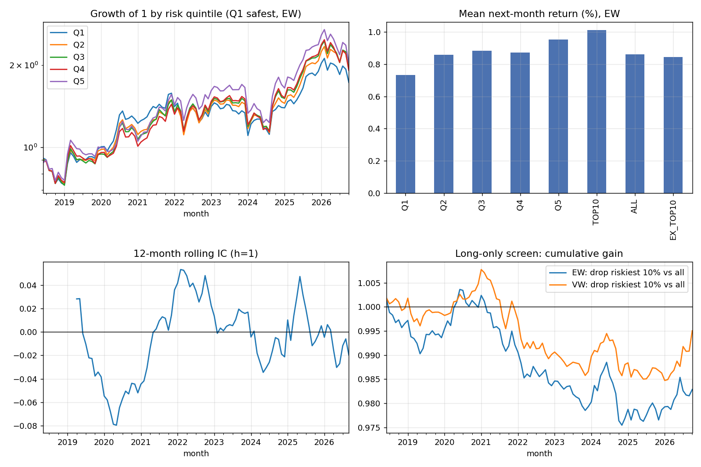

# Screener risk score -> A-share returns

- Data: REAL (walk-forward screener scores + Sina monthly prices via AKShare)
- Scores: `alpha/output/scores_walkforward_default.csv` (FY Y score usable from 1 May of Y+1)
- Sample: 2018-05 to 2026-09 formation months (101), 5,051 stocks, avg 4,168 stocks/month
- Filters: >= 6 months since listing; traded in the formation month; next month's price available

**Hypothesis:** higher risk score -> lower future return (mean IC < 0, Q1 - Q5 > 0, dropping the riskiest 10% helps).

## 1. Information coefficient (Spearman)
|   horizon_m |   mean_IC |   IC_t_NW |   IC_std |   pct_months_IC<0 |   months |
|------------:|----------:|----------:|---------:|------------------:|---------:|
|           1 |   -0.0044 |   -0.4358 |   0.0945 |            0.4752 | 101.0000 |
|           3 |    0.0039 |    0.2260 |   0.1050 |            0.4646 |  99.0000 |
|           6 |    0.0086 |    0.3691 |   0.1120 |            0.4375 |  96.0000 |
|          12 |    0.0121 |    0.3995 |   0.1078 |            0.4222 |  90.0000 |

## 2. Portfolios, next-month return (equal-weighted)
|          |   mean_monthly |   t_NW |   ann_return |   ann_vol |   sharpe |   max_drawdown |   months |
|:---------|---------------:|-------:|-------------:|----------:|---------:|---------------:|---------:|
| Q1       |         0.0073 | 1.3326 |       0.0880 |    0.2163 |   0.4068 |        -0.2992 | 101.0000 |
| Q2       |         0.0086 | 1.5581 |       0.1031 |    0.2244 |   0.4594 |        -0.2538 | 101.0000 |
| Q3       |         0.0088 | 1.5213 |       0.1060 |    0.2356 |   0.4500 |        -0.2402 | 101.0000 |
| Q4       |         0.0087 | 1.4681 |       0.1047 |    0.2373 |   0.4413 |        -0.2600 | 101.0000 |
| Q5       |         0.0095 | 1.5391 |       0.1143 |    0.2460 |   0.4648 |        -0.2753 | 101.0000 |
| TOP10    |         0.0101 | 1.6488 |       0.1215 |    0.2461 |   0.4939 |        -0.2819 | 101.0000 |
| ALL      |         0.0086 | 1.5101 |       0.1032 |    0.2293 |   0.4501 |        -0.2447 | 101.0000 |
| EX_TOP10 |         0.0084 | 1.4867 |       0.1012 |    0.2282 |   0.4434 |        -0.2448 | 101.0000 |

## 3. Long-only screen and long-short
SCREEN_GAIN = (all stocks minus the riskiest 10%) - (all stocks). LS_Q1_Q5 is theoretical (shorting A-shares is very limited).
|                                       |   mean_monthly |    t_NW |     ann |   hit_rate |   months |
|:--------------------------------------|---------------:|--------:|--------:|-----------:|---------:|
| ('equal-weighted', 'SCREEN_GAIN')     |        -0.0002 | -0.9679 | -0.0020 |     0.4356 | 101.0000 |
| ('equal-weighted', 'LS_Q1_Q5')        |        -0.0022 | -0.7624 | -0.0263 |     0.4653 | 101.0000 |
| ('float-cap-weighted', 'SCREEN_GAIN') |        -0.0000 | -0.2957 | -0.0006 |     0.4950 | 101.0000 |
| ('float-cap-weighted', 'LS_Q1_Q5')    |         0.0003 |  0.0772 |  0.0038 |     0.4851 | 101.0000 |

## 4. Fama-MacBeth (score_rank: -0.5 safest .. +0.5 riskiest, so its coefficient = monthly return gap riskiest vs safest)
### Score only
| variable   |   avg_coef_monthly |   t_NW |   months |
|:-----------|-------------------:|-------:|---------:|
| const      |             0.0086 | 1.5101 | 101.0000 |
| score_rank |             0.0024 | 0.6598 | 101.0000 |

### Score + size, book-to-market, momentum, 1-month reversal (controls ranked -0.5..0.5 within month)
| variable   |   avg_coef_monthly |    t_NW |   months |
|:-----------|-------------------:|--------:|---------:|
| const      |             0.0091 |  1.6095 | 101.0000 |
| score_rank |            -0.0021 | -0.7298 | 101.0000 |
| log_mcap   |            -0.0131 | -2.5558 | 101.0000 |
| log_bm     |             0.0048 |  1.1473 | 101.0000 |
| mom_12_2   |             0.0036 |  0.7868 | 101.0000 |
| rev_1m     |            -0.0090 | -1.8862 | 101.0000 |

## 5. Size
| group             |   mean_IC |    IC_t |   months |
|:------------------|----------:|--------:|---------:|
| small third       |    0.0208 |  1.8067 | 101.0000 |
| mid third         |   -0.0198 | -2.3933 | 101.0000 |
| large third       |   -0.0284 | -2.8932 | 101.0000 |
| drop smallest 30% |   -0.0201 | -1.9401 | 101.0000 |

### Fama-MacBeth without the smallest 30% of stocks
| variable   |   avg_coef_monthly |    t_NW |   months |
|:-----------|-------------------:|--------:|---------:|
| const      |             0.0064 |  1.1552 | 101.0000 |
| score_rank |            -0.0043 | -1.4628 | 101.0000 |
| log_mcap   |            -0.0060 | -1.3198 | 101.0000 |
| log_bm     |             0.0087 |  1.6967 | 101.0000 |
| mom_12_2   |             0.0061 |  1.2341 | 101.0000 |
| rev_1m     |            -0.0067 | -1.3621 | 101.0000 |

## 6. Year by year (compounded, EW; years run June-May)
|   June-May starting |     ALL |   TOP10 |   SCREEN_GAIN |   LS_Q1_Q5 |
|--------------------:|--------:|--------:|--------------:|-----------:|
|                2018 | -0.0800 | -0.0044 |       -0.0097 |    -0.1287 |
|                2019 |  0.0781 | -0.0225 |        0.0109 |     0.2010 |
|                2020 |  0.2471 |  0.3030 |       -0.0054 |     0.0209 |
|                2021 |  0.0440 |  0.1430 |       -0.0102 |    -0.1928 |
|                2022 |  0.1469 |  0.1682 |       -0.0021 |    -0.0377 |
|                2023 | -0.1196 | -0.1494 |        0.0035 |     0.0681 |
|                2024 |  0.2811 |  0.3861 |       -0.0103 |    -0.1759 |
|                2025 |  0.3618 |  0.3032 |        0.0052 |     0.0194 |
|                2026 | -0.1580 | -0.1687 |        0.0011 |     0.0348 |

## 7. Placebo (scores shuffled across stocks once per year; compares IC t-stats)
Real IC t-stat -0.44 (mean IC -0.0044) vs shuffled t-stats -0.01 +/- 1.05; share at least as extreme: 0.715 (200 shuffles).

## Caveats
- Survivorship: the financial data contain almost only firms still listed today, so firms that were delisted (the most distressed) are missing.
- Financial statement values come from Eastmoney's current database; their announcement dates are mostly later than the original annual report, so some values may be restated versions, not exactly what investors saw in April.
- Float market cap = month-end close x outstanding shares (Sina); book-to-market uses total equity / float cap.
- No ST flags or price-limit handling; LightGBM hyper-parameters were tuned on FY2021-22 (re-run with default params to check).